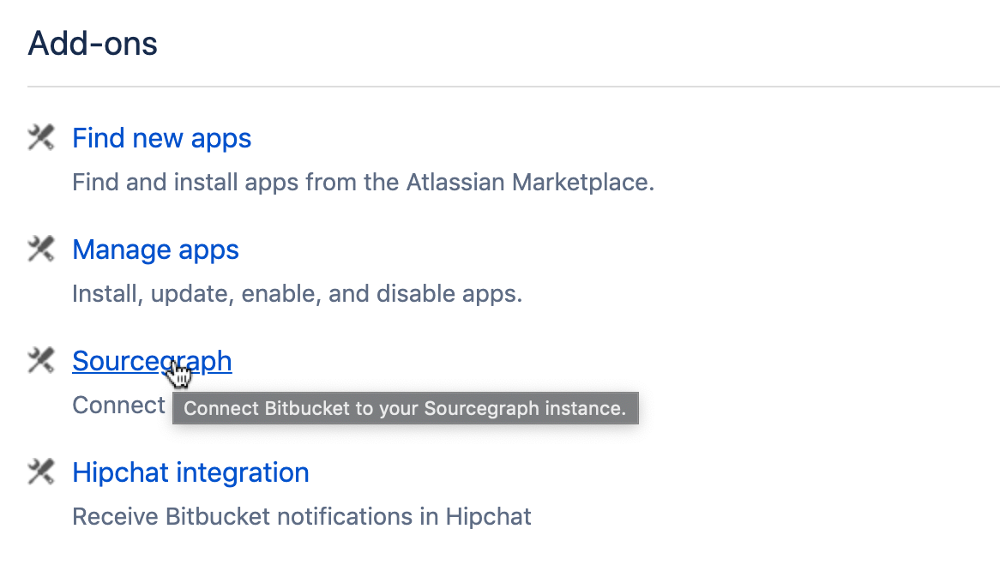
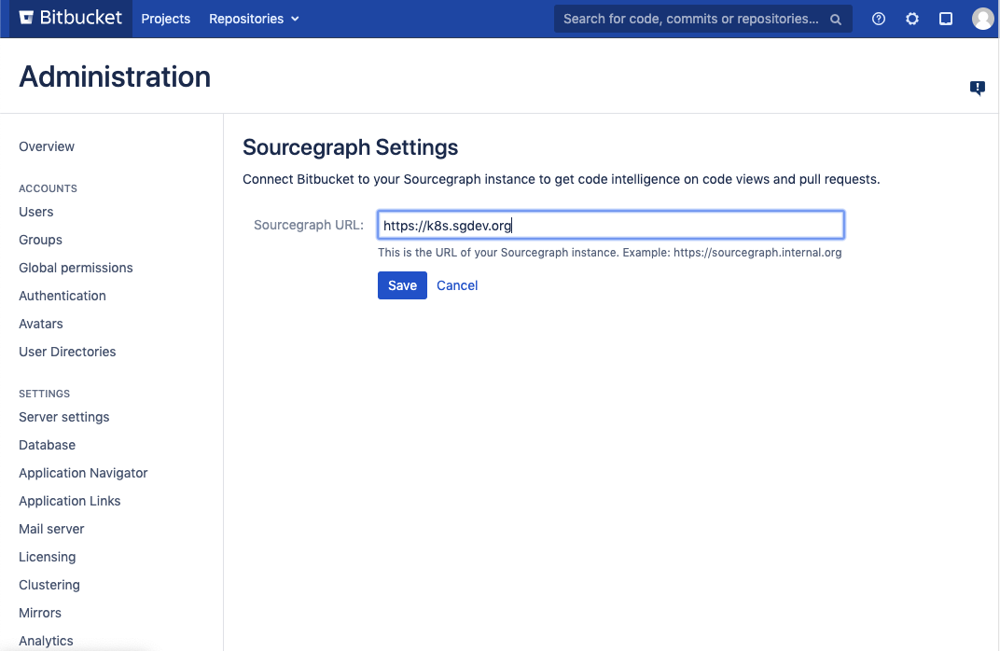
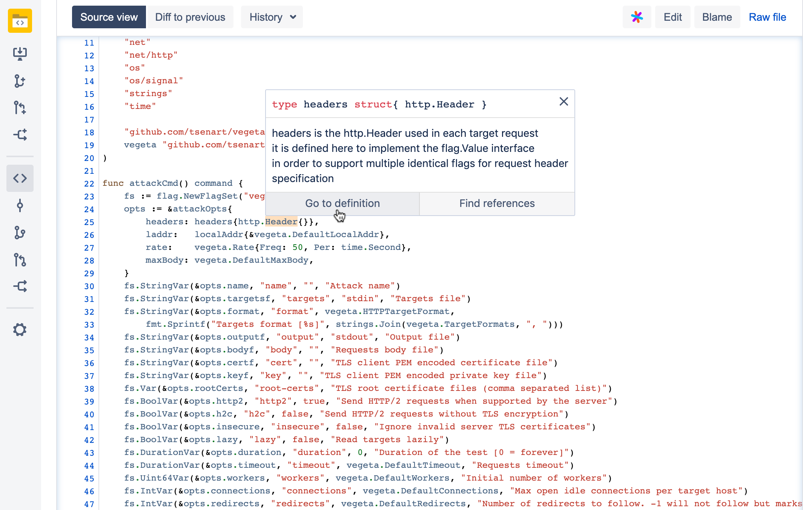

# Sourcegraph for Bitbucket Server

The Sourcegraph plugin for Bitbucket Server communicates with your Sourcegraph instance to add **code intelligence** to your Bitbucket Server code views and pull requests.

The plugin also has the optional functionality to enable **faster ACL permission syncing between Sourcegraph and Bitbucket Server** and can add **webhooks with configurable scope to Bitbucket Server**.

## Installation and Usage

### Prerequisites

1. You must have a Cloud or self-hosted Sourcegraph instance set up on v3.6 or higher.
2. Your Sourcegraph instance should have a Bitbucket Server [code host connection](https://sourcegraph.com/docs/admin/code_hosts/bitbucket_server) configured.
3. The `corsOrigin` property should be set in [site configuration](https://sourcegraph.com/docs/admin/config/site_config) to include the URL of your Bitbucket Server instance. Example value:

```json
    "corsOrigin": "https://bitbucket.example.com"
```

### Installation

#### Via the [Atlassian marketplace](https://marketplace.atlassian.com/apps/1231975/sourcegraph-for-bitbucket?hosting=datacenter&tab=pricing)

1. Log into your Bitbucket instance as an admin.
2. Click the admin dropdown and choose Add-ons.
3. Click Find new apps or Find new add-ons from the left-hand side of the page.
4. Locate "Sourcegraph for Bitbucket" via search.
5. Click Install to download and install your app.

#### Via file upload (Bitbucket 9)

1. Log in to Bitbucket Server as an admin.
2. Navigate to the Bitbucket admin page.
3. Go to **Add-ons > Manage apps**.
4. Click **Upload app**
5. In the **From this URL** field, paste the following URL:

```
https://marketplace.atlassian.com/download/apps/1231975/version/2010081
```

This is the Marketplace-hosted 3.0.2 security update for Bitbucket Data Center 9.0.0–9.6.5. It updates Guava for CVE-2026-102554 and can upgrade an existing 3.0.1 installation without removing its Sourcegraph settings or webhooks. The GCS `latest.jar` URL also serves 3.0.2; versioned GCS archives are available at `3.0.1.jar` and `3.0.2.jar`. For Bitbucket 10, install plugin 4.0.0 through Marketplace (a versioned GCS `4.0.0.jar` is archived, but direct upload requires a separately approved signature and trusted certificate). Never use `latest.jar` for Bitbucket 10.

### Updating

#### Via the Atlassian marketplace

Installing the Sourcegraph for Bitbucket Server via the Atlassian marketplace will automatically update the plugin to the latest version, if enabled, and offer new versions to administrators in the UI.

#### Via file upload

Follow the steps in [Installation](#installation) with the versioned Marketplace URL above.

### Configuration

After installing the Sourcegraph for Bitbucket Server, you need to configure it to point to your Sourcegraph instance.

1. On Bitbucket, go to the **Administration** page
2. Find the **Sourcegraph** entry under **Add-ons**:



3. On the **Sourcegraph Settings** page, set the Sourcegraph URL to the URL of your Sourcegraph instance:



### Usage

#### Native code intelligence

Once configured, Sourcegraph for Bitbucket Server adds code intelligence hovers (with **Go to definition** and **Find references**) to code views and pull requests for all users that are logged in to your self-hosted Sourcegraph instance. It also adds links to view repositories, files and diffs on Sourcegraph.



The plugin loads this integration from your Sourcegraph instance, so it changes when you upgrade Sourcegraph, not when you upgrade the plugin.

If a user is not logged in to Sourcegraph, they will still see the "View Repository on Sourcegraph" links, but code intelligence hovers will not be displayed.

#### Webhooks

The plugin sends webhooks that can be scoped globally, to a project, or to a repository, instead of Bitbucket's per-repository webhooks. Sourcegraph uses them to update repositories after pushes and to keep [Batch Changes](https://sourcegraph.com/docs/batch-changes) changesets current.

1. In Sourcegraph, create an incoming webhook for your Bitbucket Server code host connection (see [Incoming webhooks](https://sourcegraph.com/docs/admin/webhooks/incoming#bitbucket-server)).
2. In Bitbucket, go to **Administration > Add-ons > Sourcegraph** and add a webhook with scope `global`, the incoming webhook's URL as the endpoint, and its secret.
3. Subscribe to `repo:refs_changed` for repository updates and, for Batch Changes, `repo:build_status`, `pr:activity`, and `pr:participant:status`.

[See the `webhooks/README.md`](https://github.com/sourcegraph/bitbucket-server-plugin/tree/master/src/main/java/com/sourcegraph/webhook) for the event names, payloads, and REST API.

#### Faster permissions fetching

When the Bitbucket Server code host connection sets `"plugin": {"permissions": "enabled"}`, Sourcegraph fetches repository permissions from the plugin instead of paging through Bitbucket's REST API (see [Fast permission syncing](https://sourcegraph.com/docs/admin/code_hosts/bitbucket_server#fast-permission-syncing)). The plugin adds two endpoints under `/rest/sourcegraph-admin/1.0`:

- `/permissions/repositories?permission=<PERMISSION_LEVEL>`<br /> Returns **a list of repository IDs** the authenticated user has access to on the given `permission` level. Sourcegraph calls this endpoint.
- `/permissions/users?repository=<PROJECT_KEY>/<REPO_SLUG>&permission=<PERMISSION_LEVEL>`<br /> Returns **a list of user IDs** that have access to the given repository on the given `permission` level. Requires a system admin.

`PERMISSION_LEVEL` is `read`, `write`, or `admin`. The lists returned by both endpoints are encoded as [Roaring Bitmaps](https://roaringbitmap.org/).
