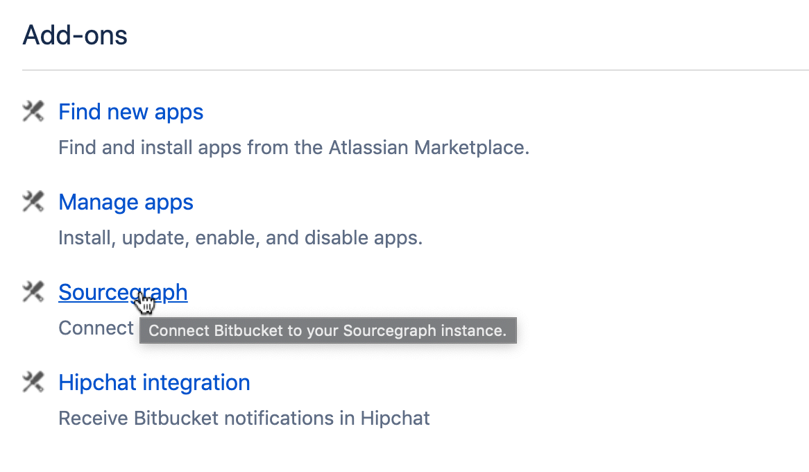
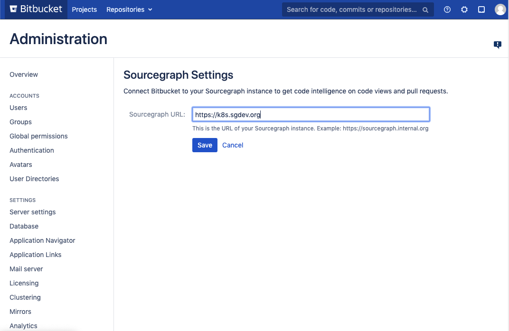
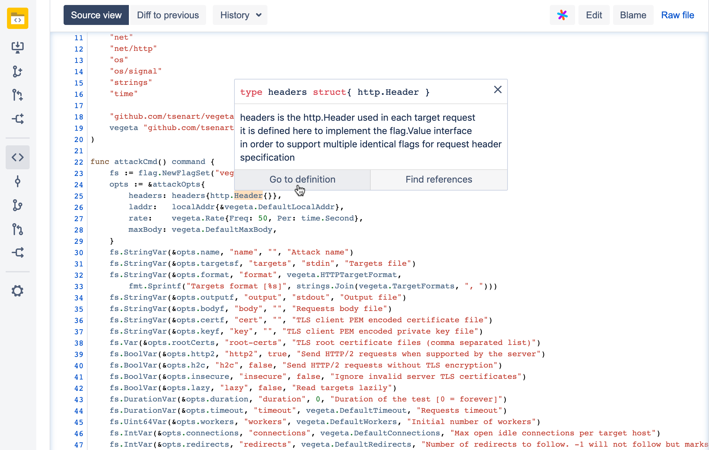

# Sourcegraph for Bitbucket Server

The Sourcegraph plugin for Bitbucket Server communicates with your Sourcegraph instance to add **code intelligence** to your Bitbucket Server code views and pull requests.

The plugin also has the optional functionality to enable **faster ACL permission syncing between Sourcegraph and Bitbucket Server** and can add **webhooks with configurable scope to Bitbucket Server**.

## Installation and Usage

### Compatibility

- **Bitbucket Data Center 9:** use plugin **3.0.1**. The existing GCS `latest.jar`
  remains this artifact; Marketplace currently advertises 9.0.0–9.6.5.
- **Bitbucket Data Center 10:** the **4.0.0 release candidate** uses Java 21 and
  Jakarta and is tested on 10.0.2, 10.1.5, 10.2.8, 10.3.2, 10.4.3, and 10.5.1.
  Repository availability does not mean it has been published to Marketplace.
  Do not install the Bitbucket 9 JAR or merely widen its compatibility bounds.

Code intelligence on Bitbucket 10 also requires the updated Bitbucket browser
adapter in your **Sourcegraph instance's integration bundle**. Installing the JAR
does not update that bundle. Confirm your Sourcegraph release includes that fix;
the historical Sourcegraph minimum below is not a Bitbucket 10 guarantee. See
[development and release guidance](DEVELOPMENT.md) for verification and publishing.

Bitbucket 10 disables Basic authentication by default. Use bearer PATs for REST.
Git HTTP also needs a Sourcegraph release with Bitbucket bearer-token cloning;
older Sourcegraph versions send the token using Basic authentication. Alternatively,
configure the connector with `gitURLType: "ssh"` and `gitSSHCredential`. Do not
re-enable Basic authentication just to work around an older connector.

### Prerequisites

1. You must have a Cloud or self-hosted Sourcegraph instance set up on v3.6 or higher.
2. Your Sourcegraph instance should have a Bitbucket Server [code host connection](https://sourcegraph.com/docs/admin/code_hosts/bitbucket_server) configured.
3. The `corsOrigin` property should be set in [site configuration](https://sourcegraph.com/docs/admin/config/site_config) to include the URL of your Bitbucket Server instance. Example value:

```json
    "corsOrigin": "https://bitbucket.example.com"
```

### Installation

#### Via the [Atlassian marketplace](https://marketplace.atlassian.com/apps/1231975/sourcegraph-for-bitbucket?hosting=datacenter&tab=pricing)

1. Log into your Bitbucket instance as an admin.
2. Click the admin dropdown and choose Add-ons.
3. Click Find new apps or Find new add-ons from the left-hand side of the page.
4. Locate "Sourcegraph for Bitbucket" via search.
5. Click Install to download and install your app.

#### Via file upload

The URL below is for **Bitbucket 9 only**. For Bitbucket 10, prefer the compatible
Marketplace release once published, or an explicitly versioned 4.x artifact with
an approved signature and trusted verification certificate. Bitbucket 10 enables
UPM signature verification by default; do not disable it to install this plugin.

1. Log in to Bitbucket Server as an admin.
2. Navigate to the Bitbucket admin page.
3. Go to **Add-ons > Manage apps**.
4. Click **Upload app**
5. In the **From this URL** field, paste the following URL:

```
https://storage.googleapis.com/sourcegraph-for-bitbucket-server/latest.jar
```

### Updating

#### Via the Atlassian marketplace

Installing the Sourcegraph for Bitbucket Server via the Atlassian marketplace will automatically update the plugin to the latest version, if enabled, and offer new versions to administrators in the UI.

#### Via file upload

Follow the steps in [Installation](#installation).

### Configuration

After installing the Sourcegraph for Bitbucket Server, you need to configure it to point to your Sourcegraph instance.

1. On Bitbucket, go to the **Administration** page
2. Find the **Sourcegraph** entry under **Add-ons**:



3. On the **Sourcegraph Settings** page, set the Sourcegraph URL to the URL of your Sourcegraph instance:



### Usage

#### Native code intelligence

Once configured, Sourcegraph for Bitbucket Server will add code intelligence hovers to code views and pull requests for all users that are logged in to your self-hosted Sourcegraph instance. It will also add links to view repositories, files and diffs on Sourcegraph.



Additionally, activated [Sourcegraph extensions](https://docs.sourcegraph.com/extensions) will be able to add information to Bitbucket server code views and pull requests, such as test coverage data or trace/log information.

If a user is not logged in to Sourcegraph, they will still see the "View Repository on Sourcegraph" links, but code intelligence hovers as well as any data contributed by Sourcegraph extensions will not be displayed.

#### Webhooks

Go to **Administration > Add-ons > Sourcegraph** to see a list of all configured webhooks and to create a new one.

[See the `webhooks/README.md`](https://github.com/sourcegraph/bitbucket-server-plugin/tree/master/src/main/java/com/sourcegraph/webhook) for more details.

#### Faster permissions fetching

Sourcegraph for Bitbucket Server adds two REST endpoints to provide more efficient endpoints for fetching permissions data:

- `/permissions/repositories?user=<USERNAME>&permission=<PERMISSION_LEVEL>`<br /> Returns **a list of repository IDs** the given `user` has access to on the given `permission` level.
- `/permissions/users?repository=<REPO>&permission=<PERMISSION_LEVEL>`<br /> Returns **a list of user IDs** that have access to the given `repository` on the given `permission` level.

The lists returned by both endpoints are encoded as [Roaring Bitmaps](https://roaringbitmap.org/).
